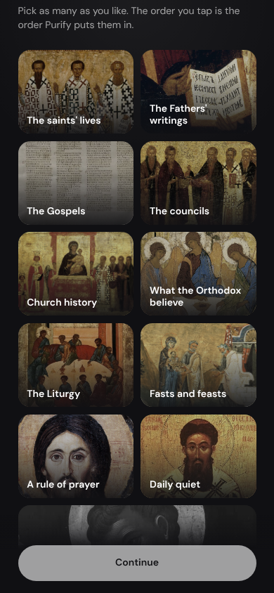
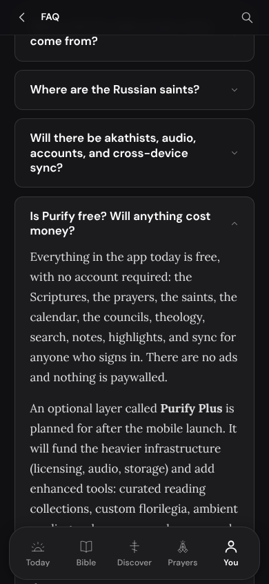
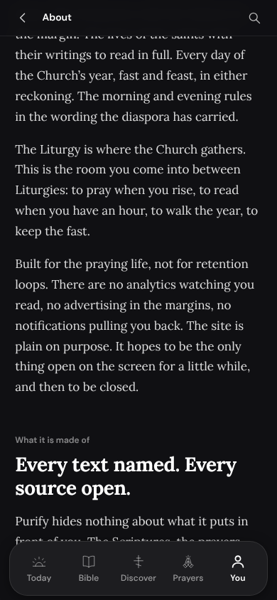
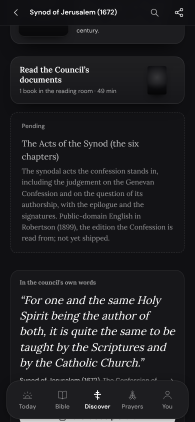
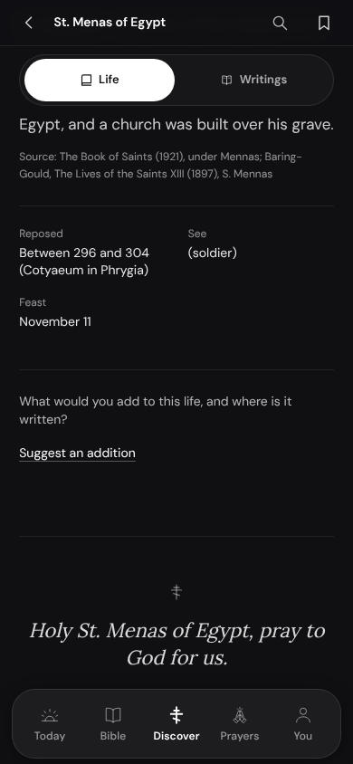
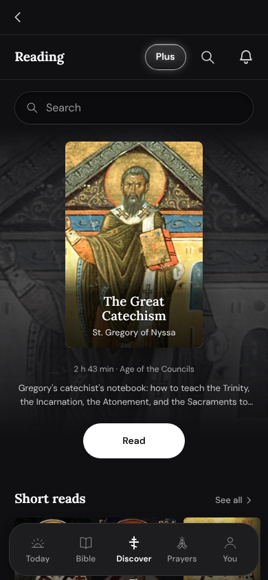
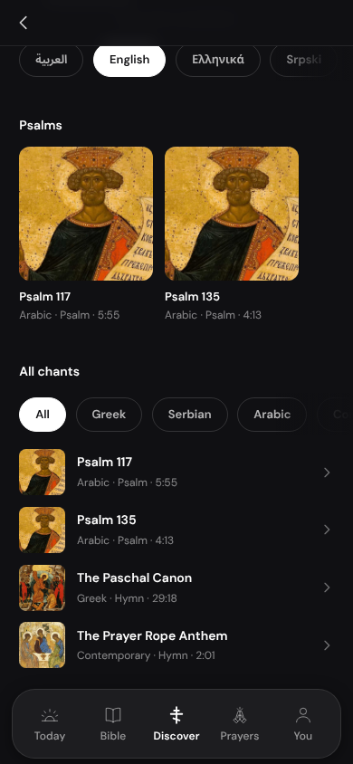
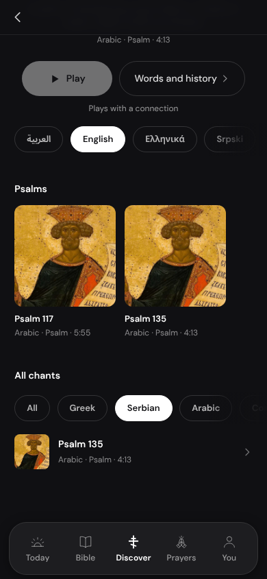
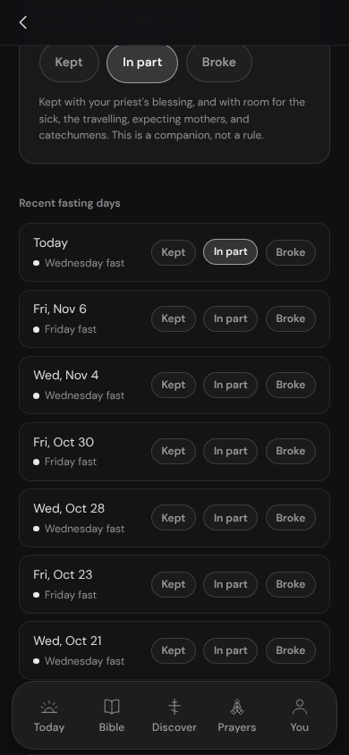
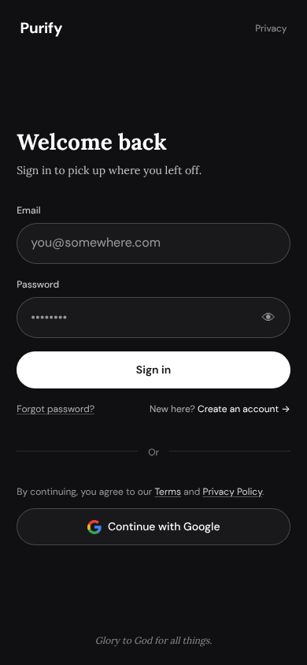

# Fresh eyes on 1.9 (the pre-build gate, part 6)

A review, 2026-11-11. No code changed. The native export was built from
`5830e1a4` as the releases build it (shop and community on, the main web's
address) and walked as a brand-new reader at 390 by 844 with real touch, then
sampled at 360 and 320 wide and in Arabic. His twenty-one notes in
`build-93.md` are known and are not repeated here.

## For Edgar, in one screen

The build is in better shape than build 93 was. Most screens are clean: no
side stripes, no light rays, no broken pictures, nothing wider than the screen
at 320, and Arabic mirrors properly.

Three things should be fixed before you see the next build:

1. **Onboarding opens one screen in the wrong place.** "What are you looking
   for?" opens scrolled down. Its title and the Back and Skip buttons are off
   the top of the screen. It is the fourth thing a new reader sees.
2. **The FAQ says things that are no longer true.** "Everything in the app
   today is free ... nothing is paywalled", and "Purify Plus is planned for
   after the mobile launch". Same kind as your note 10.
3. **About says "no analytics" and "no notifications pulling you back".** The
   app does keep anonymous counts (which screen was open when the app was
   closed, first open, came back) and runs A/B tests, and it sends reminders.
   The Privacy page tells the truth about this; About contradicts it. This
   one needs your word, because it is a promise about privacy.

Then six middling ones (a dashed "Pending, not yet shipped" box on councils,
"See (soldier)" on 99 saints, two top bars on the reading room, the chants
filter jumping under the finger, small fasting buttons, a typed emoji for
"show password") and a short list of small ones.

What I could not judge: anything signed in, anything Plus, sound, and a real
phone. Campaigns, journal sharing, sync and the Bibles' downloads need the 1.9
website, so they are named below and not called broken.

## How it was walked

- `npm run build:android`, then the export served the way the phones' shells
  serve it (`scripts/lib/shell-server.mjs`): one document, the router after it,
  nothing from outside the bundle. The website's own pictures (covers,
  history's media) were answered from this branch's `public/`, which is what
  the 1.9 website will serve. No API, no account, no sound.
- Onboarding by hand, from a device that has never opened Purify.
- A crawl from the five tabs: 135 screens of 80 kinds, each pictured at the top
  and one screen down, each measured (pictures that did not load, files the
  bundle lacks, dashed boxes, sparkle glyphs, keyboard hints, targets under
  44px, anything wider than the screen, em dashes, empty circles).
- A tap walk: every control on one screen of each kind, tapped once with
  `Input.dispatchTouchEvent`, a cold start before each tap that changed the
  screen. 50 kinds of screen were done when this was written, 276 taps that
  opened something or were flagged, 110 sheets and menus pictured.
- `scripts/mock-check.mjs` on 28 screens, five palettes each.
- 45 screens at 320 wide, 45 at 360, 26 in Arabic.
- The house's own gesture checks (`scripts/export-walk.mjs --sections 12`):
  every check passed on this export.

The tools are kept beside this file so the second pass can run them again:
`fresh-eyes/walk.mjs` (crawl and taps), `fresh-eyes/drive.mjs` (a walk by
hand, step by step), `fresh-eyes/sheets.py` (contact sheets).

```
npm run build:android
node docs/1.9-build/notes/fresh-eyes/walk.mjs crawl
node docs/1.9-build/notes/fresh-eyes/walk.mjs taps --part 0/4      (and 1/4, 2/4, 3/4)
node docs/1.9-build/notes/fresh-eyes/walk.mjs crawl --width 320 --max 45
node docs/1.9-build/notes/fresh-eyes/walk.mjs crawl --lang ar --max 45
node docs/1.9-build/notes/fresh-eyes/drive.mjs onb --fresh -- tap:Begin tap:Orthodox tap:Continue tap:Practicing tap:Continue shot list
```

## Findings, most serious first

Areas are my best reading of the lanes in `HANDOFF.md` and `build-93.md`; the
arbiter knows better who holds what.

### High

#### H1. Onboarding: "What are you looking for?" opens scrolled down



- Steps: a new reader, Begin, Orthodox, Continue, Practicing, Continue.
- What happens: the step opens 114px down its own scroll. The title, Back and
  Skip are above the screen (Back and Skip measured at y = -101). The reader
  lands on "Pick as many as you like" with no heading and no way out in sight.
- With it: on the step before (calendar and fasting rule) the Continue button
  sits at y 810 to 861 on an 844 screen, so it is cut by the foot until the
  reader scrolls (`fresh-eyes/01b-onboarding-continue-cut.png`). Scrolling to
  reach it is what leaves the next step scrolled.
- Where: `components/onboarding/OnboardingFlow.tsx:694`, the one scroller
  (`lm-hero fixed inset-0 ... overflow-y-auto`) is never put back to the top
  when the step changes.
- Smallest fix: set that element's `scrollTop` to 0 on every step change, and
  let the calendar step's Continue stay in view (pin the button to the foot, or
  tighten the step).
- Area: the onboarding chat's work; Updates 2 if it is closed.

#### H2. The FAQ says everything is free and Plus is still to come



- Steps: You, Settings, Terms (or About), FAQ, "Is Purify free? Will anything
  cost money?".
- The words: "Everything in the app today is free, with no account required:
  ... notes, highlights, and sync for anyone who signs in. There are no ads and
  nothing is paywalled." Then: "An optional layer called Purify Plus is planned
  for after the mobile launch."
- Not true since Plus: the Plus sheet one tap away sells reading modes, word
  study and plans, and the Florilegium's own page says sync is Plus.
- Where: `app/(app)/faq/page.tsx:143-146`; the lines are
  `ui.everythingInTheAppToday` and `ui.isPlannedForAfterThe` in
  `lib/i18n/messages/en.json` (and the 20 other languages).
- Smallest fix: rewrite the two paragraphs to what is free and what Plus adds,
  from the same list the Plus page uses. Pricing words are his to sign off.
- Area: Admin, with note 10 and the words test (gate part 4). That test should
  read the FAQ and About too.

#### H3. About promises "no analytics" and "no notifications pulling you back"



- Steps: You, Settings, About.
- The words: "There are no analytics watching you read, no advertising in the
  margins, no notifications pulling you back." Further down: "There is no
  analytics layer." The FAQ adds "no analytics" for readers without an account.
- What the app does: anonymous counts of which kind of screen was open when
  the app was put away, first opens and returns (`lib/analytics/screenCounting.ts`,
  sent by `lib/analytics/screenCount.ts`), feature and lock counts, and A/B
  tests (`lib/ab/`). It also offers prayer reminders. None of it names a
  reader, and `components/legal/PrivacyText.tsx:236` onward says so plainly.
  So About and Privacy disagree.
- Where: `app/(app)/about/page.tsx:51` and `:116`
  (`ui.builtForThePrayingLife`, `ui.thereIsNoAnalyticsLayer`),
  `app/(app)/faq/page.tsx:174` (`ui.noAnalyticsNoThirdParty`).
- Smallest fix: say what is true, in the Privacy page's own terms: no
  advertising, no third-party trackers, nothing tied to who you are; anonymous
  totals only. "No notifications pulling you back" becomes reminders only if
  you ask for them.
- Area: Admin drafts; **his word before it ships** (a privacy promise).

### Medium

#### M1. A dashed "Pending ... not yet shipped" box on a council's page



- Steps: Discover, Councils, Synod of Jerusalem (1672), scroll to "Read the
  Council's documents". Any council with pending documents shows it.
- A dashed placeholder box (his note 4 rule) holding a document the app does
  not carry, ending "not yet shipped".
- Where: `app/(app)/councils/[slug]/page.tsx:218` (`border-dashed`); the words
  come from `lib/councils/councils.ts`.
- Smallest fix: do not draw pending documents for readers. If one must show,
  a plain quiet line with no box and no "shipped".
- Area: Fable Theology (councils), or the December saints chat.
- **Done** (the December saints chat, 2026-11-11): the page draws no pending
  documents; they stay in `lib/councils/councils.ts` for the editors. Held by
  `lib/councils/__tests__/noPendingBox.test.ts`, which fails on the old page.

#### M2. Saints' facts print "See" over a bracketed role: "See (soldier)"



- Steps: Today, tap the saint of the day (St Menas, 11 November), scroll to
  the facts under the tabs.
- 99 saints carry a bracketed stand-in where a bishop's see would be:
  "(martyrs)" 19, "(martyr)" 10, "(monk)" 9, "(abbot)" 9, "(soldier)" 4 and
  more. Under the label "See" it reads as a mistake.
- Where: the values in `lib/saints/saints.ts` (for example line 5378); drawn
  by `components/saints/SaintFacts.tsx:21` and
  `components/saints/SaintStudyRail.tsx:20`.
- Smallest fix: skip the See fact when the value begins with "(".
- Area: the December saints chat.
- **Done** (the December saints chat, 2026-11-11): the 99 bracketed roles are
  out of `see`, and so are 39 other values that are no see (the apostles'
  missions, the emperors and empresses, monasteries, "(lay)", "(deacon)",
  "(martyred)", the Theotokos's "Jerusalem"); Sts Cyril and Methodius keep St
  Methodius's Sirmium. A see now stands only on a bishop (the Apostle Peter
  by name), held by `lib/saints/__tests__/see.test.ts`, which fails on the old
  data.

#### M3. The reading room has two top bars



- Steps: Discover, Reading.
- The Back bar, then a second bar under it: "Reading", Plus, search, bell.
  Every other page under Discover has one bar.
- Where: `components/reading/ReadingRoom.tsx:300`
  (`<MobileHeader titleKey="nav.reading" sticky={false} />`) inside a page
  that already gets the app's Back bar.
- Smallest fix: drop the inner header in the apps, keep the title as the
  page's own heading.
- Area: Updates.

Done (Updates, 2026-11-11, `022e4f971`; after: `fresh-eyes/06b-reading-one-bar-after.png`). The reading page mounts its own bar, Back to Discover and "Reading", as Councils and Theology do, and the apps' back bar stands aside for it; the room drew the tab roots' header inside itself, and no longer does. `lib/nav/__tests__/tabHeader.test.ts` holds the tab's own bar to the five tab roots (it fails on the old code); export walk section 71 counts one bar.

#### M4. Chants: choosing a filter moves the page 137px under the finger

 

- Steps: Discover, Chants, scroll to "All chants", tap Serbian (or Greek,
  Arabic, Contemporary).
- The list gets shorter, the page gets shorter (1567 to 1375px), the scroll is
  pulled back (668 to 531) and the row of filters drops from y 439 to 576
  while the finger is on it. His note 16 kind.
- Where: `components/chants/ChantsHome.tsx:73` (the "All chants" section).
- Smallest fix: hold the list's height while a filter is chosen (a
  `min-height` of the full list), so the filters keep their place.
- Area: Updates (with the other "moves under the finger" notes).
- checkMock on this screen also says one icon is placed with left, not start
  (`mirror`: an svg at 71 to 89px that sits at 303 to 321px in Arabic).

#### M5. Fasting: thirty 29px buttons, a faint line, and a row that shifts



- Steps: Today, the streak card or the fast line, "Keep the fast, day by day".
- Each past day's Kept, In part and Broke are 29px tall (44 is the rule); ten
  days of them is a column of thirty small pills. checkMock: `target` fails on
  all three.
- "Your marks stay on this device. With Purify Plus ..." is `text-paper/40`:
  3.82:1 on Dark, 2.31:1 on Light, 2.86:1 on Candlelight (4.5:1 needed).
- Marking today shifts the three buttons 19px up under the finger (the line
  above re-wraps).
- Kept turns a fixed green (`emerald-400`), the only colour on the page that
  does not follow the palette.
- Where: `components/fasting/FastingTrackerClient.tsx:72` (the small size),
  `:68` (emerald), `:265` (the faint line).
- Smallest fix: 44px rows for past days (one control that cycles, or the three
  at full height), the note at `text-paper/60`, palette tokens for Kept.
- Area: Updates.
- **Done** (Fable Themes, 2026-11-11, `8a5c3cf7`; the buttons came to it from
  Updates on the arbiter's word): the marks take a finger over 44px and are
  drawn as they were; marking a day moves nothing (0px, walked); the note is
  45, a share each palette draws at its own safe strength; Kept is the
  palette's own soft green and Broke its soft red, each read on five palettes
  with the mark on. The tap walk's "1 days kept in all." is counted in 21
  languages. After: `fresh-eyes/M5-fasting-marked-after.png`,
  `M5-fasting-marked-after-light.png`, `M5-fasting-note-after-light.png`.
  Record: `notes/themes-fable.md`, section 46.

The count that let them slip (Updates, 2026-11-11, `0258a5320`): their height was made of padding around a line of words, which the touch count could not read. It reads it now (`lib/ui/__tests__/touchTargets.test.ts`, paddedHeight), saw 90, and fell to 76 with the fourteen in Updates' areas (the reader's preference pills, Today's English switch, Search's tabs, the book switcher, the Bible sidebar and study rail, the chapter sheet's doors); the 76 left are listed by area in the test.

#### M6. Sign in and Create account: a typed emoji and 19px links



- Steps: You, Sign in (and Create an account).
- "Show password" is a typed 👁 (and 🙈 when shown), not an icon from
  `components/ui/icons`. checkMock: `glyph` fails. It also stays on the right
  in Arabic (`mirror` fails).
- "Forgot password?" and "New here? Create an account" are 19px tall; the
  "Privacy" link at the top is 19px and the Purify wordmark 29px.
- The Create account form shows "Edgar" as the sample display name.
- Where: `components/auth/PasswordInput.tsx:65`; `app/(auth)/layout.tsx:27-38`.
- Smallest fix: the house's Eye icon, placed with `end`; `min-h-11` on the
  four links; a neutral sample name.
- Area: Updates 2.

### Low

- **L1. The Hours: "Pray with chant" floats over the prayer's words.** Prayers,
  The Hours, any hour, scroll: a pill sits mid-screen across a line of the
  Trisagion (`fresh-eyes/11-hours-chant-pill-over-words.png`). A floating pill
  where it does not belong. Area: Updates, with notes 2 and 14.
  **Done** (Fable Themes, 2026-11-11, `5ac031d0`, on the arbiter's word):
  the chant is a button in the prayer page's bar beside search, shown at the
  moment the pill showed, and nothing floats over the prayer. Its coming
  moves nothing in the bar, and it mirrors in Arabic. Before and after:
  `fresh-eyes/L1-hours-chant-pill-before.png`,
  `L1-hours-chant-in-bar-after.png`. Record: `notes/themes-fable.md`,
  section 45.
- **L2. The Bible's "v 7 of 38 · 3 min left" line lies across the verse under
  it** while scrolling (`fresh-eyes/13-bible-status-over-verse.png`; the same on
  a Father's work: "Hymn I of 19 · 13 min left"). `components/bible/ChapterVerseStatus.tsx:122`
  gives it a ground, but the page's fade behind it lets the verse show through.
  Area: Updates 2.
- **L3. Reading plans: marking a day read pushes the list down 41px** under the
  finger, because "1 day in a row" is added above it
  (`fresh-eyes/12a-plan-before.png`, `12b-plan-after-mark.png`). Bible, Reading
  plans, The Nativity Fast, tap day 1's circle. Keep the line's room from the
  start. Area: Updates.
- **L4. What's new, the older notes.** Notes sit four boxes deep
  (`fresh-eyes/10-whats-new-sparkle.png`), and old notes speak to a computer:
  "Ctrl+K (Cmd+K on a Mac)", "Hover any paragraph", "a hard
  window.location.reload()". They come from `data/changelog/`. The sparkle in
  that picture was in my build and is already gone on the branch
  (`0f1e1102`). Area: Admin.
- **L5. Two more faint lines.** Start here: the step numbers are
  `text-paper/35`, 2.05:1 on Light where large text needs 3:1
  (`components/start/StartHere.tsx:77`). Community: the house rules line
  "Speak with charity ..." is 3.82:1 on Dark, 2.31:1 on Light. Area: Admin's
  guardrail walk should catch both.
  **Done** (Fable Themes, 2026-11-11, `94e49e90`): the step numbers are 50
  and the house rules line 45, shares each palette draws at its own safe
  strength; both screens pass the guardrail walk. Before and after:
  `fresh-eyes/L5-start-numbers-before-light.png`,
  `L5-start-numbers-after-light.png`, `L5-community-rules-after-light.png`.
- **L6. Privacy speaks to a browser inside the app:** "open /account and click
  'Remove this name' ... clear site data for this origin in your browser
  settings" (`components/legal/PrivacyText.tsx`). Legal text, so his word.
- **L7. Saints: choosing a kind ("Apostles") removes the featured card above
  and re-scrolls the page** (762 to 27). The filters end up about 50px from
  where the finger was. Mild next to M4; the same fix would settle it.

## Seen again, already in his notes (not counted above)

These were still in my build; the fixes may have landed since.

- Back lands at the top: the Bible's book list, Prayers, Theology's subjects,
  the reading room's rows (note 1).
- The prayer book's sections open and the page jumps the wrong way (note 15).
- Settings: the dashed Councils and Cappadocian looks (note 4); a look on the
  Reading mode page that opens under the tab bar (note 15).
- Your rule, Morning: "Nothing here yet" beside a dashed circle (note 16).
- A work with a plain cover: Gangra's Synodical Letter, the First Apology in
  my first crawl (note 18).
- St Alexander's empty circle on Nicaea (note 1).

## What needs the 1.9 website (not called broken)

- **Campaigns.** `/campaigns/` drew "404, This page is not in our index. The
  link may be wrong, or the page may not be built yet." in my walk
  (`fresh-eyes/14-campaigns-404.png`), because nothing answered whether
  campaigns are open. Worth one look by the campaigns chat: a reader with no
  signal, or whom the server tells no, should not meet a 404 that says "may
  not be built yet".
- **Community** ("Try again"), **the shop's stores** ("We couldn't reach the
  shop"), **notifications from other readers**, **the patron saint**, **packs**
  (the chosen verses and the board message), **journal sharing**, **sync**, and
  **the Bibles' downloads** all ask the website and could not be judged.
- **Sound.** Chants and read-aloud ask `audio.purifyapp.net`; nothing played.
- The app also asked Supabase for `data_moves` on every cold start, signed out.
  Harmless, but it is a request a new reader with no account does not need.

## What passed

- No side stripe and no light rays on any of the 28 screens checkMock read.
- No picture failed to load once the website's pictures were served from the
  branch (0 missing of every cover and history picture asked for).
- Nothing wider than the screen at 320 or 360 on 45 screens each.
- Arabic: the tab bar, top bar, cards, lists and sheets mirror on the 26
  screens walked. Saints' names and the dictionary stay in English, as built.
- The verse's hold, its focus card and tools, the note sheet, the chapter
  picker, search, the streak sheet, the Plus sheet, the verse picture sheet,
  history's filter sheet: all open whole on the screen.
- The house's gesture checks (section 12 of `export-walk.mjs`): all passed.

## What this pass did not cover

- Anything signed in (the account pages redirect to Sign in), anything a
  reader with Plus sees, the reading looks worn across the app.
- A real phone: R8, the keyboard, the status bar, haptics, the system Back.
- iOS and the tablet layouts.
- The tap walk had done 50 of the 68 kinds of screen when this was written;
  it runs on, and anything new goes to the arbiter.
- The journal's composer, Easy Scroll, the rule's end, the Florilegium's
  gatherings and Learn by heart, since they are being rebuilt under his notes.

## The second pass

On the arbiter's word, on the release candidate: the same commands above, then
each of his twenty-one notes and each finding here checked by hand with
`drive.mjs`, and a list of which are gone.

## Addendum: the tap walk finished (all 68 kinds of screen)

Nothing new of its own kind. More places with his note 15 fault (what opens
ends under the tab bar and the page does not move with it), for the one helper
Fable Theology is building to cover:

- FAQ: every answer that opens near the foot (five flagged, ending 70 to 200px
  under the bar). `app/(app)/faq/page.tsx`.
- Terms and Privacy: the "Contents" list (ends 280 to 530px under the bar).
  `components/legal/LegalContents.tsx`.
- What's new: a month, and the 1.9 note itself. Opening the year also pulls the
  page back 200px.

Two small "moves under the finger" to look at with the others: Sign in's
"Continue with Google" shifts 24px on the first tap (an error line appears
above it with no network), and a council document's "Next" bar shifts 47px
when tapped.
