# The Nativity Fast posts (1.8)

His yes of 2026-11-10 ("ok to all", the sheet's 39): a post every three days through the
Nativity Fast, 15 November to 24 December. Planned and drafted here; nothing is made or
posted. He posts.

## What each post is

- **One reading of the day**, from the app's own Toward the Nativity path
  (`lib/reading/paths.ts`, id `nativity`): the day's reading on Today, quoted word for word
  from the text the app shows (`data/saints/`), and cited. Every quote below was checked
  against that text by a script, letter for letter.
- **No sentence with an exclamation mark or a dash** is quoted, so every caption keeps the
  drop's writing rules without changing a word of the Fathers: where a reading opens with
  one, another whole sentence of the same reading is quoted.
- **One picture, the app itself**: Today on that day in the 1.8 build, its Nativity Fast
  card at the top, the star a little higher each time, and the day's Verse of the Day
  below it, as the app draws them (`components/today/NativityStarCard.tsx`). Taken on
  10 November at his yes, with the clock on each day; nothing on the screen changed. One
  still a post, 1080 by 1350, in `nativity-fast/` beside this file.
- **Where**: Instagram and TikTok, as a picture post. No link, five hashtags, no emoji.
- **New Calendar dates**, as the app keeps them by default. On the Old Calendar the same
  days fall thirteen days later, and the app moves its path with them.

## The fourteen posts

| Day | Date | Reading | The words |
|---|---|---|---|
| 1 | Sun 15 Nov | St Justin Martyr, First Apology 31 | “There were, then, among the Jews certain men who were prophets of God, through whom the prophetic Spirit published beforehand things that were to come to pass, ere ever they happened.” |
| 4 | Wed 18 Nov | St Ephraim the Syrian, Hymns on the Nativity II | “Glory to the Silence, that spake by His Voice.” |
| 7 | Sat 21 Nov | Luke 1:46-47, the Magnificat | “My soul doth magnify the Lord, and my spirit hath rejoiced in God my Saviour.” |
| 10 | Tue 24 Nov | St Ephraim the Syrian, Hymns on the Nativity V | “At the birth of the Son, there was a great shouting in Bethlehem; for the Angels came down, and gave praise there.” |
| 13 | Fri 27 Nov | St Ephraim the Syrian, Hymns on the Nativity VII | “He made Himself a pure body, He clothed Himself with it, and came forth and clothed our weakness with glory, which in His mercy He brought from the Father.” |
| 16 | Mon 30 Nov | St Ephraim the Syrian, Hymns on the Nativity IX | “Come rest, and be still in the bosom of Thy Mother, Son of the Glorious.” |
| 19 | Thu 3 Dec | St Ephraim the Syrian, Hymns on the Nativity XI | “I shall not be jealous, my Son, that Thou art with me, and also with all men.” |
| 22 | Sun 6 Dec | St Ephraim the Syrian, Hymns on the Nativity XIII | “In the days of the king who enrolled men in the book of the dead, our Redeemer came down and enrolled men in the book of the living.” |
| 25 | Wed 9 Dec | St Ephraim the Syrian, Hymns on the Nativity XV | “Even my feeble tongue, has become a harp through His mercy.” |
| 28 | Sat 12 Dec | St Ephraim the Syrian, Hymns on the Nativity XVII | “The Scribes read daily, that the Star arises out of Jacob.” |
| 31 | Tue 15 Dec | St John Chrysostom, Homilies on Matthew 2 | “And what is marvellous, thou wilt see death destroyed by death, and curse extinguished by curse, and the dominion of the devil put down by those very things whereby he did prevail.” |
| 34 | Fri 18 Dec | Matthew 1:23, as St John Chrysostom reads it in his Homilies on Matthew 5 | “Behold, a Virgin shall be with child, and shall bring forth a Son, and they shall call His name Emmanuel.” |
| 37 | Mon 21 Dec | Luke 2:13-14, as St Cyril of Alexandria reads it in his Commentary on Luke, Sermon 2 | “And suddenly there was with the angel a multitude of the heavenly hosts, praising God and saying, Glory to God in the highest, and on earth peace, and among men good will.” |
| 40 | Thu 24 Dec | St Gregory the Theologian, Oration 38, On the Nativity, 13 | “And He Who gives riches becomes poor, for He assumes the poverty of my flesh, that I may assume the richness of His Godhead.” |

## The captions

The same shape each time: the day, the words, whose they are, and where the reading is.

### Day 1, Sun 15 Nov

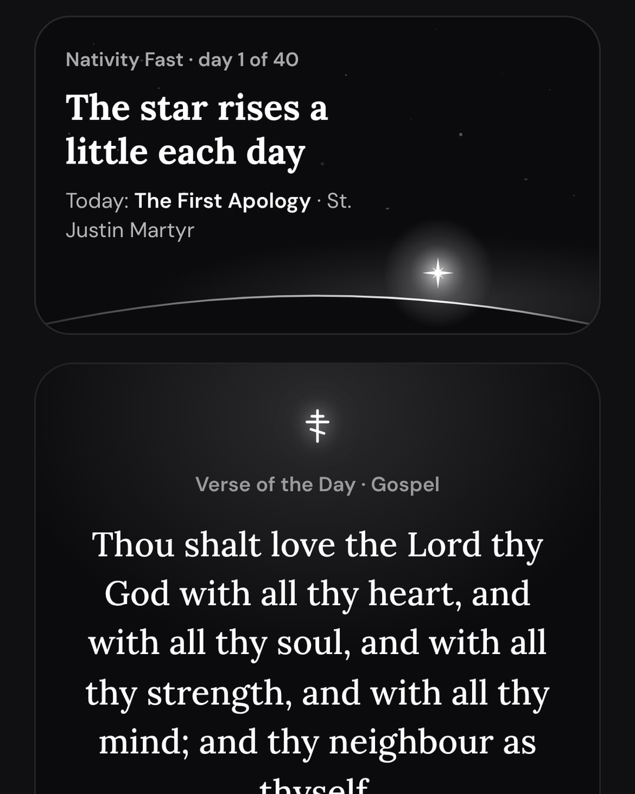

~~~text
Day 1 of the Nativity Fast. "There were, then, among the Jews certain men who were prophets of God, through whom the prophetic Spirit published beforehand things that were to come to pass, ere ever they happened." St Justin Martyr, First Apology 31. Today's reading in Toward the Nativity, forty days with the Fathers, in Purify: Orthodox Hub. #orthodox #orthodoxchristian #nativityfast #saints #prayer
~~~

### Day 4, Wed 18 Nov

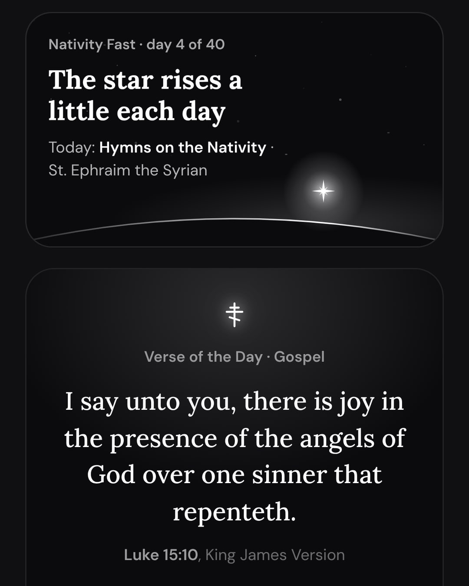

~~~text
Day 4 of the Nativity Fast. "Glory to the Silence, that spake by His Voice." St Ephraim the Syrian, Hymns on the Nativity II. Today's reading in Toward the Nativity, forty days with the Fathers, in Purify: Orthodox Hub. #orthodox #orthodoxchristian #nativityfast #saints #prayer
~~~

### Day 7, Sat 21 Nov

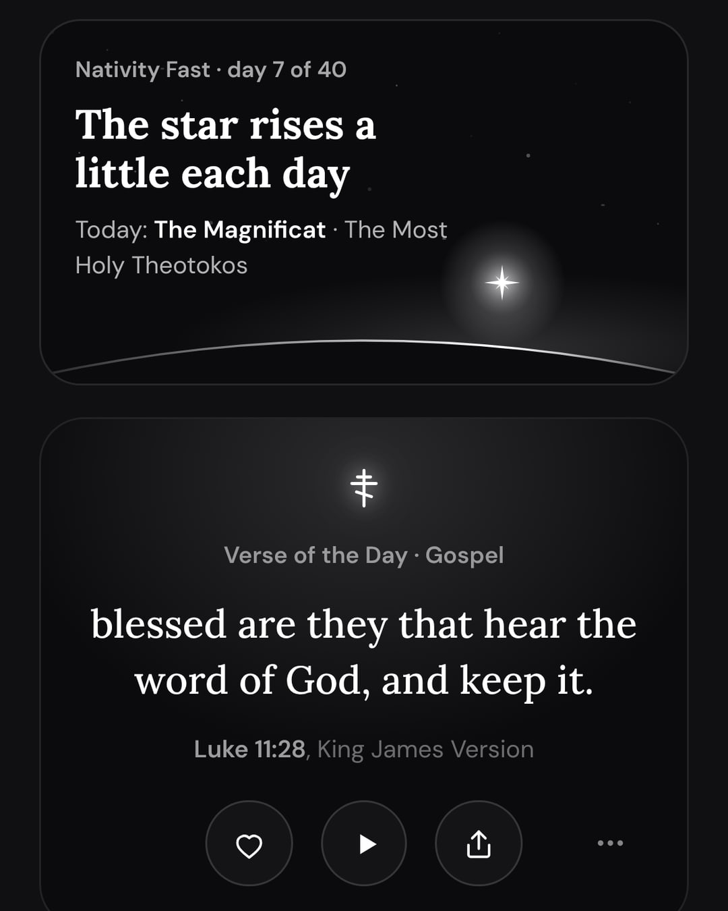

~~~text
Day 7 of the Nativity Fast. "My soul doth magnify the Lord, and my spirit hath rejoiced in God my Saviour." Luke 1:46-47, the Magnificat. Today's reading in Toward the Nativity, forty days with the Fathers, in Purify: Orthodox Hub. #orthodox #orthodoxchristian #nativityfast #saints #prayer
~~~

### Day 10, Tue 24 Nov

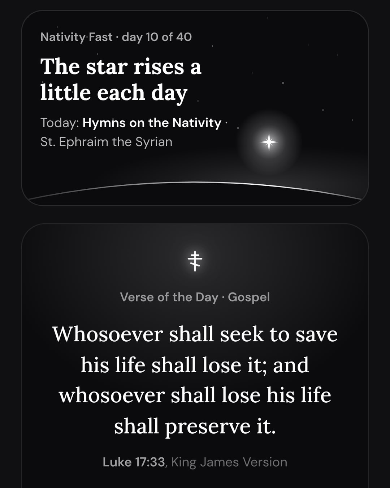

~~~text
Day 10 of the Nativity Fast. "At the birth of the Son, there was a great shouting in Bethlehem; for the Angels came down, and gave praise there." St Ephraim the Syrian, Hymns on the Nativity V. Today's reading in Toward the Nativity, forty days with the Fathers, in Purify: Orthodox Hub. #orthodox #orthodoxchristian #nativityfast #saints #prayer
~~~

### Day 13, Fri 27 Nov

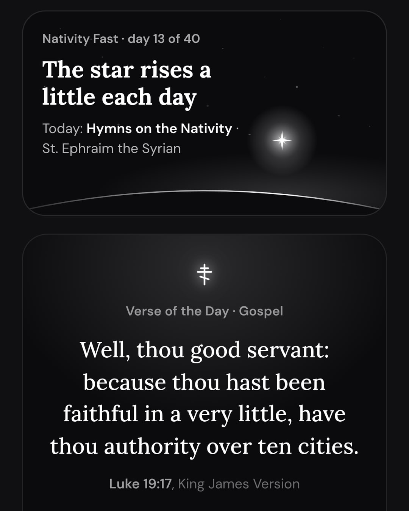

~~~text
Day 13 of the Nativity Fast. "He made Himself a pure body, He clothed Himself with it, and came forth and clothed our weakness with glory, which in His mercy He brought from the Father." St Ephraim the Syrian, Hymns on the Nativity VII. Today's reading in Toward the Nativity, forty days with the Fathers, in Purify: Orthodox Hub. #orthodox #orthodoxchristian #nativityfast #saints #prayer
~~~

### Day 16, Mon 30 Nov

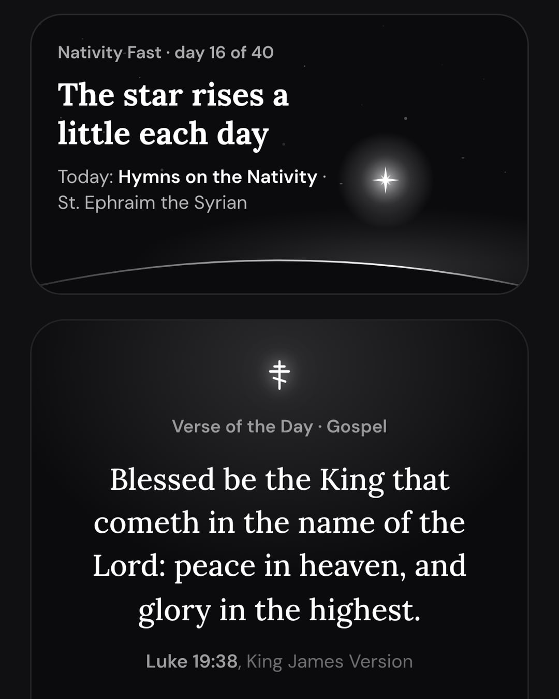

~~~text
Day 16 of the Nativity Fast. "Come rest, and be still in the bosom of Thy Mother, Son of the Glorious." St Ephraim the Syrian, Hymns on the Nativity IX. Today's reading in Toward the Nativity, forty days with the Fathers, in Purify: Orthodox Hub. #orthodox #orthodoxchristian #nativityfast #saints #prayer
~~~

### Day 19, Thu 3 Dec

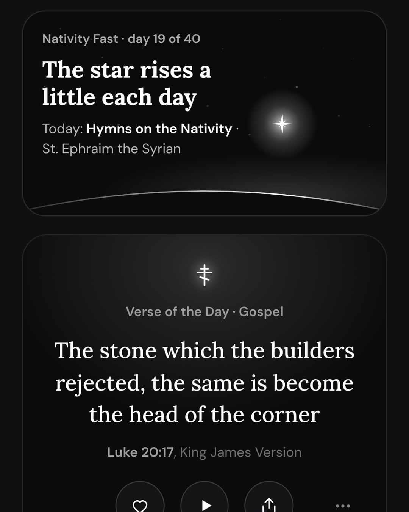

~~~text
Day 19 of the Nativity Fast. "I shall not be jealous, my Son, that Thou art with me, and also with all men." St Ephraim the Syrian, Hymns on the Nativity XI. Today's reading in Toward the Nativity, forty days with the Fathers, in Purify: Orthodox Hub. #orthodox #orthodoxchristian #nativityfast #saints #prayer
~~~

### Day 22, Sun 6 Dec

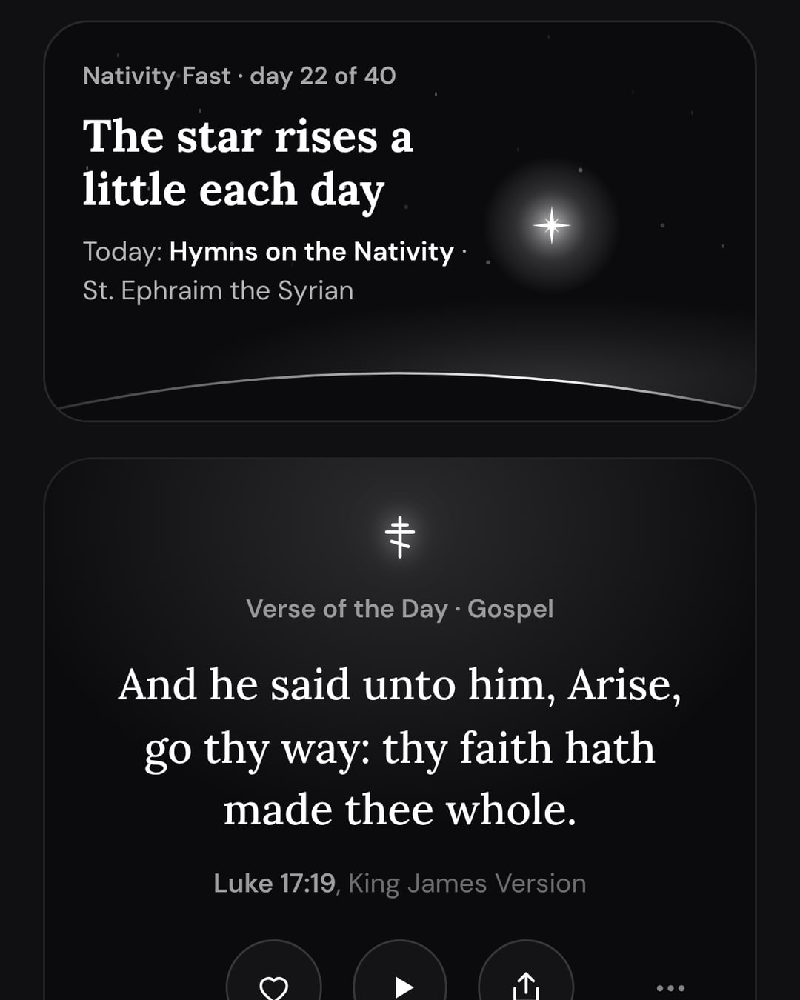

~~~text
Day 22 of the Nativity Fast. "In the days of the king who enrolled men in the book of the dead, our Redeemer came down and enrolled men in the book of the living." St Ephraim the Syrian, Hymns on the Nativity XIII. Today's reading in Toward the Nativity, forty days with the Fathers, in Purify: Orthodox Hub. #orthodox #orthodoxchristian #nativityfast #saints #prayer
~~~

### Day 25, Wed 9 Dec

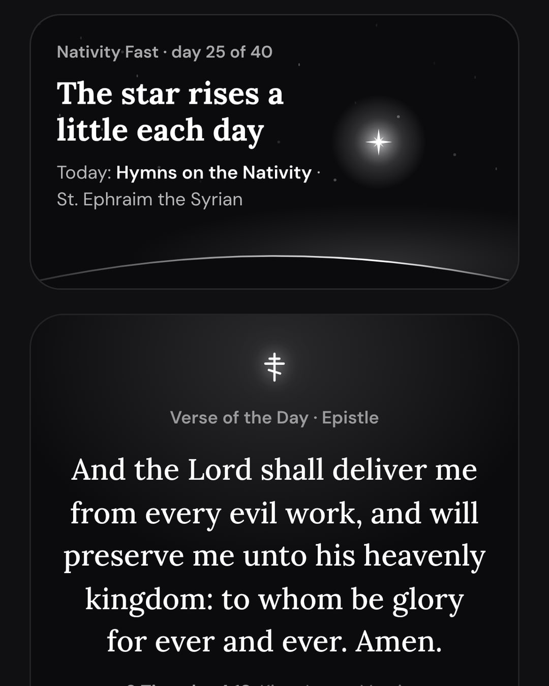

~~~text
Day 25 of the Nativity Fast. "Even my feeble tongue, has become a harp through His mercy." St Ephraim the Syrian, Hymns on the Nativity XV. Today's reading in Toward the Nativity, forty days with the Fathers, in Purify: Orthodox Hub. #orthodox #orthodoxchristian #nativityfast #saints #prayer
~~~

### Day 28, Sat 12 Dec

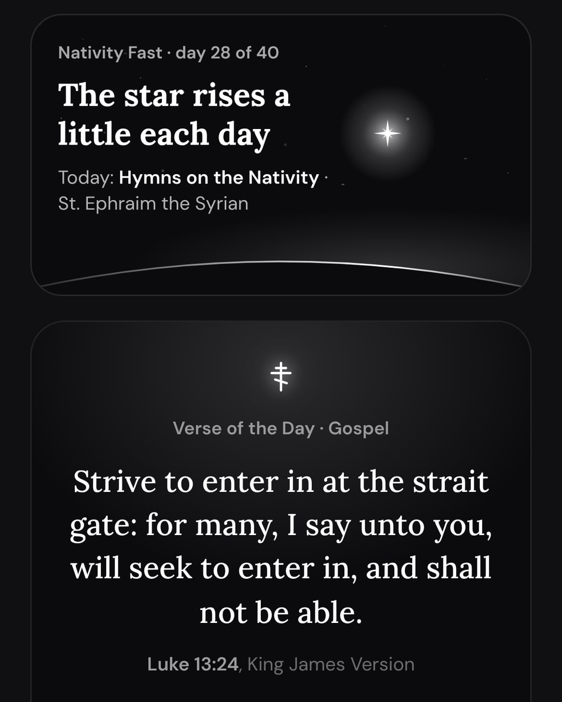

~~~text
Day 28 of the Nativity Fast. "The Scribes read daily, that the Star arises out of Jacob." St Ephraim the Syrian, Hymns on the Nativity XVII. Today's reading in Toward the Nativity, forty days with the Fathers, in Purify: Orthodox Hub. #orthodox #orthodoxchristian #nativityfast #saints #prayer
~~~

### Day 31, Tue 15 Dec

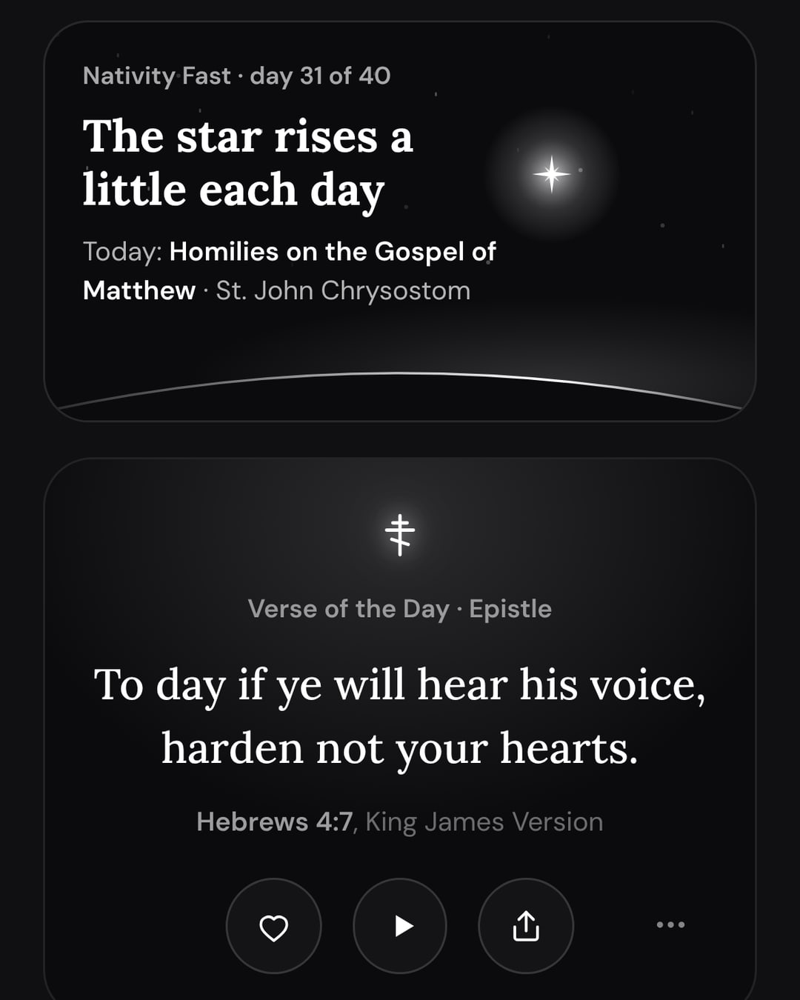

~~~text
Day 31 of the Nativity Fast. "And what is marvellous, thou wilt see death destroyed by death, and curse extinguished by curse, and the dominion of the devil put down by those very things whereby he did prevail." St John Chrysostom, Homilies on Matthew 2. Today's reading in Toward the Nativity, forty days with the Fathers, in Purify: Orthodox Hub. #orthodox #orthodoxchristian #nativityfast #saints #prayer
~~~

### Day 34, Fri 18 Dec

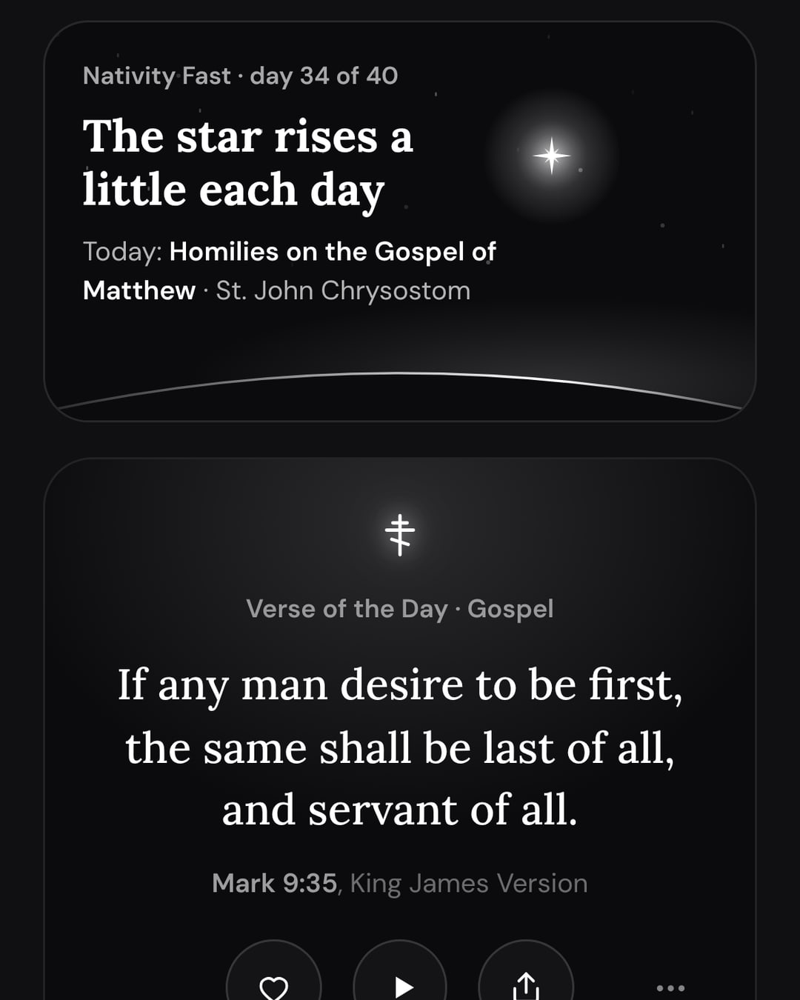

~~~text
Day 34 of the Nativity Fast. "Behold, a Virgin shall be with child, and shall bring forth a Son, and they shall call His name Emmanuel." Matthew 1:23, as St John Chrysostom reads it in his Homilies on Matthew 5. Today's reading in Toward the Nativity, forty days with the Fathers, in Purify: Orthodox Hub. #orthodox #orthodoxchristian #nativityfast #saints #prayer
~~~

### Day 37, Mon 21 Dec

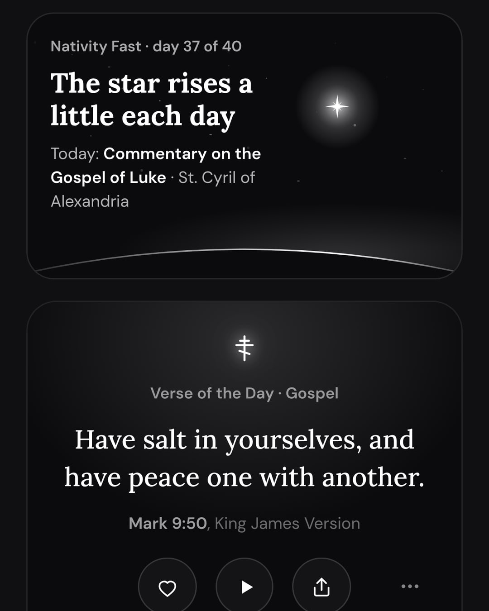

~~~text
Day 37 of the Nativity Fast. "And suddenly there was with the angel a multitude of the heavenly hosts, praising God and saying, Glory to God in the highest, and on earth peace, and among men good will." Luke 2:13-14, as St Cyril of Alexandria reads it in his Commentary on Luke, Sermon 2. Today's reading in Toward the Nativity, forty days with the Fathers, in Purify: Orthodox Hub. #orthodox #orthodoxchristian #nativityfast #saints #prayer
~~~

### Day 40, Thu 24 Dec

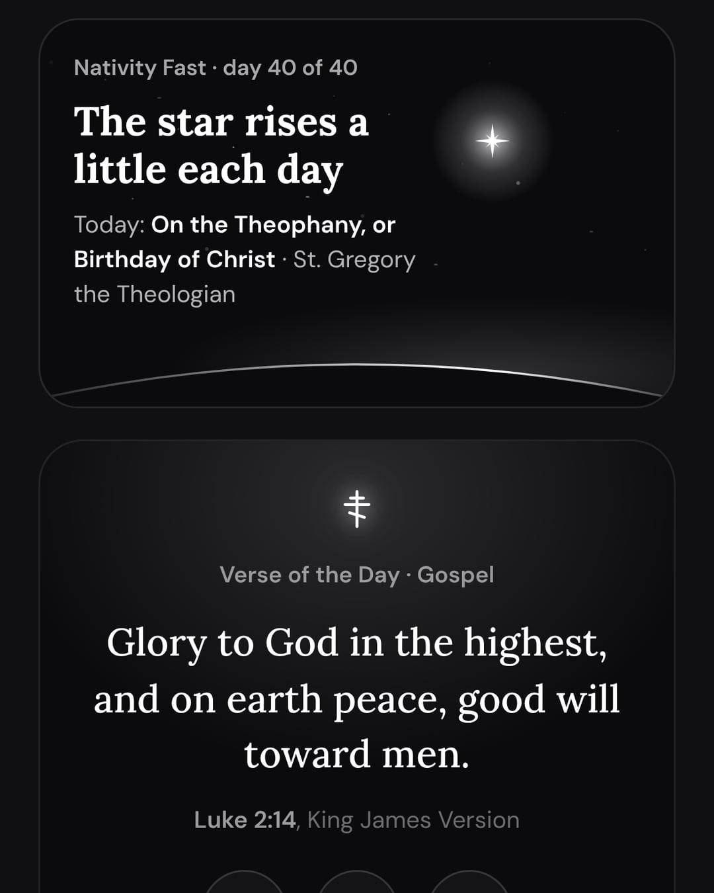

~~~text
Day 40 of the Nativity Fast. "And He Who gives riches becomes poor, for He assumes the poverty of my flesh, that I may assume the richness of His Godhead." St Gregory the Theologian, Oration 38, On the Nativity, 13. Today's reading in Toward the Nativity, forty days with the Fathers, in Purify: Orthodox Hub. #orthodox #orthodoxchristian #nativityfast #saints #prayer
~~~
